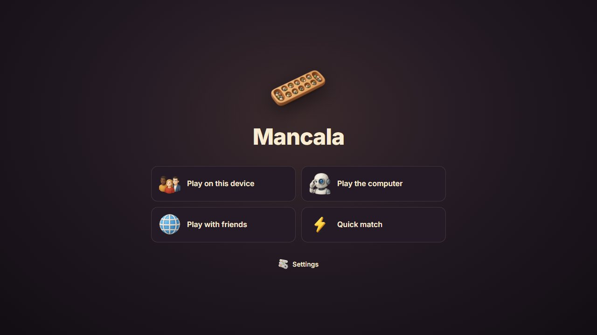

# Mancala

A two-player Mancala game with two rule sets, Kalah and Ayo. It started as a Java Swing game and now also runs on the web, where you can play on one device, against the computer, or online with a friend.

**Play it:** https://mancala.danieldombrovsky9.workers.dev




## Features

- **Two rule sets:** Kalah, with captures and extra turns, and Ayo, with relay sowing and no extra turns.
- **Four ways to play on the web:** on one device, against the computer (easy, medium or hard), online with a friend using a 5-digit game code, or against a stranger with quick match.
- **Saved games:** games on one device or against the computer are kept in the browser and offered for resume. Online games are stored on the server, and a player who loses their seat can take it back with the code.
- **Animated board:** every stone moves on its own as it is sown, relayed, captured and banked.
- **Custom looks:** walnut, oak or ebony boards and four stone sets, or the original Java version's looks: Classic, the grid of Swing buttons, and Text, the console where you type a pit number. Chosen in Settings on the home page or during a game. The browser also remembers your name.
- **Before the first move:** choose who goes first, or flip a coin for it.
- **In a game:** a log of every move, Start over, Resign and Leave, all from Settings.
- **Confetti** when the game ends.
- **The original Java version** is still here, with its own animated Swing board.

## Running the web version

`web/` is a Cloudflare Worker with a D1 database. `web/public/engine.js` holds the rules and the computer opponent, and is shared by the browser and the Worker, which checks every online move. Running it locally needs Node 22:

```
cd web
npm install
npm run db:local   # creates the local database tables, once
npm run dev        # http://localhost:8789
```

To publish, run `npx wrangler deploy` from `web/`.

## Running the Java version

Java 11 or newer is required.

With Gradle:

```
gradle build
java -cp build/classes/java/main ui.MancalaGUI
```

Without Gradle:

```
javac -d out $(find src/main/java -name "*.java")
java -cp out ui.MancalaGUI
```

The original text version is still available with `java -cp build/classes/java/main ui.TextUI`.

## Project layout

- `src/main/java/mancala/` is the game model: the board, pits, stores, players and both rule sets.
- `web/` is the web version: `public/` holds the pages, rules engine and artwork, and `src/index.js` is the Worker.
- `src/main/java/ui/` is the Swing interface (`MancalaGUI`, `HomePanel`, `BoardPanel`, `SetupDialog`) and the text interface (`TextUI`).

## Author

Daniel Dombrovsky

## Credits

Confetti uses [canvas-confetti](https://github.com/catdad/canvas-confetti) (ISC licence, see `CONFETTI-LICENSE.txt`).
