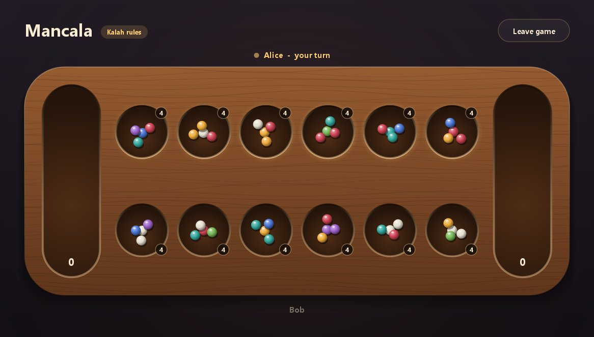

# Mancala

A two-player Mancala game in Java with two rule sets, Kalah and Ayo. Each stone you sow, relay and capture is animated on a hand-drawn Swing board.




## Features

- **Two rule sets:** Kalah, with captures and extra turns, and Ayo, with relay sowing and no extra turns.
- **Animated board:** stones move pit by pit, and the current player's row is highlighted.
- **Named players:** both players enter a name before the game, and duplicate names are rejected.
- **Runs in the browser too:** the same JAR runs on a web page through CheerpJ, with nothing to install.

## Running it

Java 11 or newer is required.

With Gradle:

```
gradle build
java -cp build/classes/java/main ui.MancalaGUI
```

Without Gradle:

```
javac -d out $(find src/main/java -name "*.java")
java -cp out ui.MancalaGUI
```

The original text version is still available with `java -cp build/classes/java/main ui.TextUI`.

## Project layout

- `src/main/java/mancala/` is the game model: the board, pits, stores, players and both rule sets.
- `src/main/java/ui/` is the Swing interface (`MancalaGUI`, `HomePanel`, `BoardPanel`, `SetupDialog`) and the text interface (`TextUI`).

## Author

Daniel Dombrovsky
